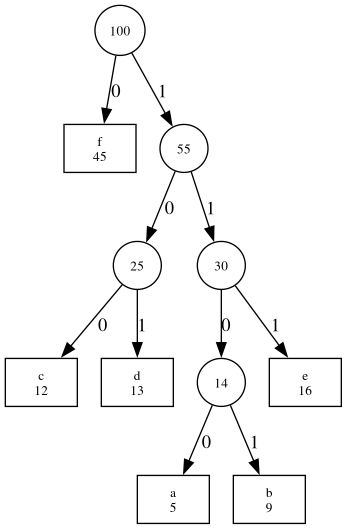

# Compresión de texto con Huffman (español, francés e inglés)

Implementación completa del algoritmo de Huffman visto en clase
(`huffman.py`) para comprimir y descomprimir archivos de texto, con
estadísticas de compresión en tres idiomas.

## Estructura

| Archivo | Qué hace |
|---|---|
| `huffman.py` | Código base visto en clase (árbol de Huffman y tabla de análisis). |
| `frecuencias.py` | Frecuencia de cada carácter y número promedio de bits por símbolo. |
| `visualizacion.py` | Dibuja el árbol de Huffman con Graphviz. |
| `compresor.py` | Codificación: genera el archivo `.huff`. |
| `descompresor.py` | Decodificación con diccionario inverso y con el árbol. |
| `descargar_textos.py` | Descarga el corpus (10 artículos de Wikipedia por idioma). |
| `estadisticas_compresion.py` | Tablas de compresión por archivo y por idioma. |
| `tiempos_decodificacion.py` | Compara los tiempos de los dos decodificadores. |

## Instalación

```bash
python -m venv .venv
source .venv/bin/activate
pip install -r requirements.txt
```

La visualización necesita además el programa Graphviz (`dot`) instalado en el sistema.

## Uso

```bash
python frecuencias.py textos/es/algoritmo.txt          # frecuencias y bits promedio
python visualizacion.py                                # árbol del ejemplo de clase
python compresor.py textos/es/algoritmo.txt comprimidos
python descompresor.py comprimidos/algoritmo.huff arbol        # o: diccionario
python estadisticas_compresion.py
python tiempos_decodificacion.py 300
```

## Formato del archivo `.huff`

1. **Encabezado** guardado con `pickle`: diccionario `{"codes_dic", "padding", "arbol"}`.
   - `codes_dic`: código de Huffman de cada carácter como string.
   - `padding`: bits de relleno al final del último byte.
   - `arbol`: el árbol de Huffman (nodo raíz).
2. **Bits comprimidos**, escritos con `bitarray.tofile()`.

Los códigos se convierten a `bitarray` con `codes[c] = bitarray(codes_dic[c])`.

## Árbol del ejemplo de clase



## Resultados

### Compresión por archivo

| Archivo | Idioma | Tamaño original (bytes) | Tamaño comprimido (bytes) | Compression factor | Bits promedio por símbolo |
|---|---|---|---|---|---|
| algoritmo.txt | Español | 31052 | 25599 | 0.8244 | 4.8796 |
| futbol.txt | Español | 73630 | 47081 | 0.6394 | 4.5486 |
| literatura.txt | Español | 37339 | 26318 | 0.7048 | 4.4585 |
| mexico.txt | Español | 273457 | 159443 | 0.5831 | 4.5677 |
| miguel_de_cervantes.txt | Español | 59269 | 38858 | 0.6556 | 4.5481 |
| musica.txt | Español | 48978 | 33857 | 0.6913 | 4.4329 |
| paris.txt | Español | 67797 | 45623 | 0.6729 | 4.5951 |
| quimica.txt | Español | 40707 | 30789 | 0.7564 | 4.5364 |
| revolucion_francesa.txt | Español | 106543 | 64856 | 0.6087 | 4.5145 |
| sistema_solar.txt | Español | 31848 | 23269 | 0.7306 | 4.4836 |
| algorithme.txt | Francés | 20749 | 17971 | 0.8661 | 4.5126 |
| chimie.txt | Francés | 80187 | 59044 | 0.7363 | 4.7736 |
| football.txt | Francés | 138332 | 88488 | 0.6397 | 4.6732 |
| litterature.txt | Francés | 28610 | 22106 | 0.7727 | 4.5855 |
| mexique.txt | Francés | 114804 | 73550 | 0.6407 | 4.7144 |
| musique.txt | Francés | 59892 | 39545 | 0.6603 | 4.5101 |
| paris.txt | Francés | 236779 | 141949 | 0.5995 | 4.6431 |
| revolution_francaise.txt | Francés | 122729 | 75627 | 0.6162 | 4.6677 |
| systeme_solaire.txt | Francés | 109355 | 69273 | 0.6335 | 4.5961 |
| victor_hugo.txt | Francés | 121305 | 76144 | 0.6277 | 4.7155 |
| algorithm.txt | Inglés | 27067 | 21675 | 0.8008 | 4.5984 |
| association_football.txt | Inglés | 48185 | 33351 | 0.6921 | 4.5712 |
| chemistry.txt | Inglés | 44433 | 31737 | 0.7143 | 4.5151 |
| french_revolution.txt | Inglés | 85224 | 54316 | 0.6373 | 4.5597 |
| literature.txt | Inglés | 32701 | 24023 | 0.7346 | 4.5783 |
| mexico.txt | Inglés | 93716 | 60563 | 0.6462 | 4.672 |
| music.txt | Inglés | 79718 | 51834 | 0.6502 | 4.4878 |
| paris.txt | Inglés | 89079 | 59385 | 0.6667 | 4.713 |
| solar_system.txt | Inglés | 61762 | 40807 | 0.6607 | 4.562 |
| william_shakespeare.txt | Inglés | 46149 | 31388 | 0.6801 | 4.5948 |

### Compresión por idioma

| Idioma | Promedio compression factor | Promedio bits por símbolo |
|---|---|---|
| Español | 0.6867 | 4.5565 |
| Francés | 0.6793 | 4.6392 |
| Inglés | 0.6883 | 4.5852 |

### Tiempos de decodificación (300 repeticiones)

| Idioma | Archivo | Método | Repeticiones | Promedio (ms) | Desv. estándar (ms) |
|---|---|---|---|---|---|
| Español | literatura.txt | diccionario | 300 | 19.108 | 3.2523 |
| Español | literatura.txt | arbol | 300 | 23.5951 | 4.5604 |
| Francés | litterature.txt | diccionario | 300 | 15.3776 | 3.5425 |
| Francés | litterature.txt | arbol | 300 | 17.5101 | 2.0476 |
| Inglés | literature.txt | diccionario | 300 | 20.997 | 5.473 |
| Inglés | literature.txt | arbol | 300 | 24.1883 | 3.1459 |

## Observaciones

- Los tres idiomas comprimen de forma muy parecida: el texto queda en
  aproximadamente el 68–69 % de su tamaño original, con unos 4.6 bits por
  símbolo frente a los 8 bits por byte del archivo original.
- El francés necesita un poco más de bits por símbolo por su mayor variedad
  de caracteres acentuados (é, è, ê, à, ç...).
- En archivos pequeños (por ejemplo `algorithme.txt`) el compression factor
  empeora porque el encabezado (diccionario + árbol) pesa proporcionalmente más.
- El compression factor es mayor que bits_promedio / 8 porque los caracteres
  acentuados ocupan 2 bytes en UTF-8 y porque el archivo incluye el encabezado.
- La decodificación con diccionario inverso resultó ligeramente más rápida
  que recorrer el árbol nodo por nodo en Python.

Los tiempos dependen de la máquina; se pueden regenerar con
`python tiempos_decodificacion.py`.
